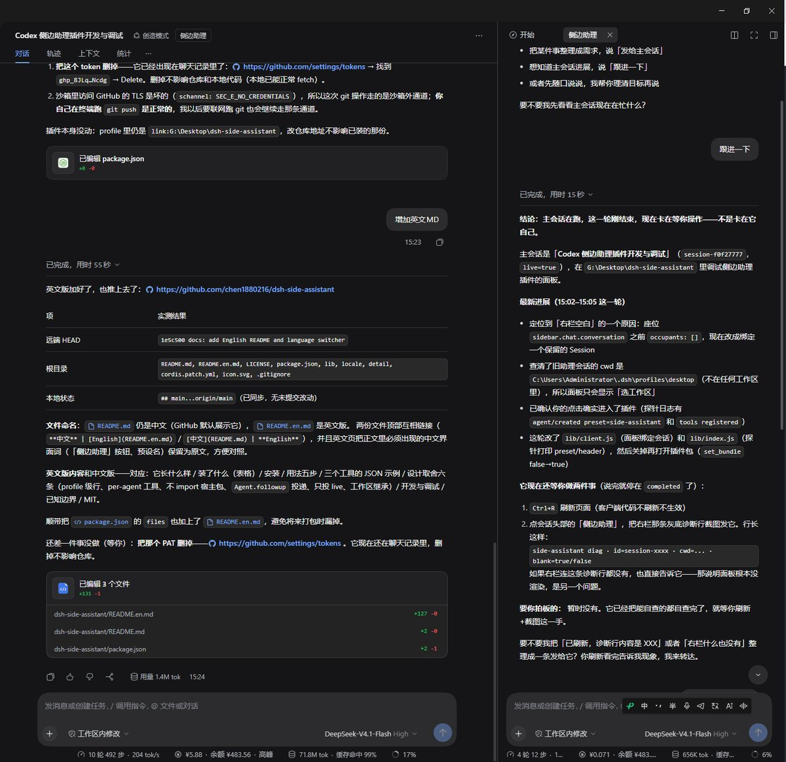
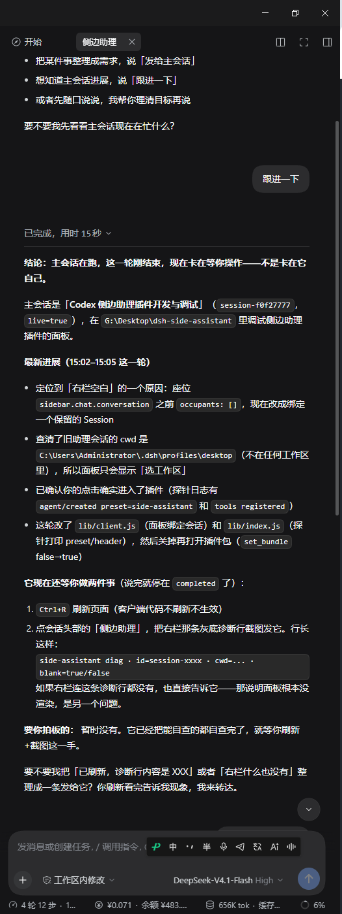

[中文](README.md) | **English**

# dsh-side-assistant



A **Chinese-speaking assistant in the right sidebar** for [DeepSeek Harness](https://github.com/deepseek-ai) (DSH).

The main session does the work. This assistant does the part humans usually need: it takes a vague request,
asks the few questions that matter, writes it up as something executable, relays it to the main session,
and later comes back and tells you how far the main session got.

## What it looks like

- Every session header gets a 「侧边助理」 button;
- Click it → a tab opens in the right sidebar with the assistant's own session, ready to chat;
- The assistant joins the **workspace** the current session belongs to (no "pick a workspace" dialog);
- Clicking again just brings the existing panel forward instead of creating new sessions.



## What it installs

| Piece | Level | Purpose |
|---|---|---|
| `side-assistant` plugin row | profile | Listens to `agent/created`, registers tools only for sessions running the assistant preset |
| `preset-side-assistant` | preset roster | The 「侧边助理」 preset: persona + time context + ask-user + compaction |
| `side_sessions` | tool | List other sessions (which one looks like the main session, whether it is running; `bound: true` marks the one you opened the panel from) |
| `side_peek` | tool | Read the recent timeline of a session (what was said, which tools ran, how each turn ended) |
| `side_deliver` | tool | Hand a written-up requirement to the main session and wake it up |
| `lib/client.js` | client | Right sidebar panel: `sideassistant` resource protocol + tab type + header entry button |
| `/api/dsh-side-assistant/bind` | host route | Tells the host which session the panel was opened from; the tools target it by default |

**No shell, no file tools.** The assistant can only *talk*. It cannot touch your files — that is the point:
letting it talk only means you never have to worry about it editing something behind your back.

## Install

This bundle is not on npm. Install it from a local directory:

1. Open the **Plugins** page → Add plugin → pick this directory (or the directory you unpacked the archive into);
2. Or use the built-in tool: `plugin_manager` → `install_bundle` with the absolute path as `target`;
3. **Reload the window** (`Ctrl+R`) afterwards — the panel is a fresh browser bundle and will not load otherwise.

A successful install returns `"application": "applied"`, and the Plugins page shows both components
(`side-assistant` and the `preset-side-assistant` Agent preset) as running.

## Usage

1. Click 「侧边助理」 in any session header → the panel opens on the right;
2. Say something loose, like "help me tweak that export script";
3. It asks back, and pins down the goal / how far to go / what must be kept;
4. You say "send it to the main session" → it calls `side_deliver`; the main session receives a
   "from session xxxx" message and starts working;
5. You say "follow up" → it calls `side_peek`, then reports the conclusion first, then what was verified,
   where it is stuck, and whether you need to decide anything.

**The default target is the session you opened the panel from.** Clicking the header entry stores the
"origin → assistant" pair in the browser and POSTs it to a small binding table on the host; `side_peek`
and `side_deliver` use it whenever `session` is omitted. Pass `session` explicitly (id, id prefix, or a
title fragment) to aim somewhere else.

For risky actions (deploy, delete data, push code) it shows you the wording it is about to send and waits
for your confirmation.

The panel's top row has a **Clear chat** button: the first click turns it into "Clear?", the second click
moves the panel to a fresh blank conversation (same main session, same workspace, binding carried over).
The previous conversation stays in your session list — DSH has no API to delete a session, so "clear"
means "start a new pot of tea", not "smash the pot".

## The three tools

```jsonc
// side_sessions — list sessions you can deliver to
{ "limit": 10 }

// side_peek — read the recent progress of one session (omitting session = the bound main session)
{ "session": "session-xxxx, an id prefix, or a title fragment", "limit": 30 }

// side_deliver — hand the requirement over (live sessions only)
{ "text": "reorder the exported fields to …", "note": "relayed by side assistant: …", "session": "optional" }
```

## Design decisions

- **The plugin row lives at profile level, not inside the preset.** Preset child plugins are resolved by
  `dsh-agent-preset` against its own `ctx.baseUrl` (the installation directory), where `@local/*` packages
  do not resolve — the whole preset then shows up as "failed to load". Profile level uses the profile's own
  resolution base, which works.
- **Tools are registered per agent.** `ctx.tools.register` layers by `scopeOf(ctx)`, so registering inside
  `agent/created` through `agent.ctx` makes the tools visible to that session only, leaving normal sessions clean.
- **No `@deepseek-ai/*` imports.** Out-of-tree plugins can only resolve bare package names declared by the
  profile; `import { defineTool } from '@deepseek-ai/dsh-tools'` fails at import time. `lib/index.js` ships
  its own `defineLocalTool` / `toSchema` producing the same `ToolDefinition` shape. Several third-party DSH
  plugins take the same approach.
- **Delivery uses `Agent.followup`.** There is no supported Service for writing into an unrelated session
  (`ctx.subagents.sendMessage` is limited to members of the same subagent tree). `ctx.agents.get(sessionId)`
  gives the live Agent, and its `followup()` is the supported "queue one turn and wake it" channel. The message
  source is `{ kind: 'agent-message', form: 'relay', senderSessionId }`, matching the existing subagent
  convention, so the UI renders it as "from session xxxx".
- **Live sessions only.** Historical sessions have no Agent handle; `side_deliver` fails loudly and tells you
  to open that session first.
- **The panel borrows the official seat.** The right sidebar is "one docking surface per session". This plugin
  registers its own `sideassistant` resource protocol and tab type, occupies the shared
  `sidebar.chat.conversation` seat, and reuses the official conversation renderer through
  `renderFactorySlot('conversation.content', …)` instead of reimplementing the message stream.
- **The assistant session is created inside the current workspace.** `sessions.create` without `cwd` falls back
  to the host default directory, which makes the panel show a workspace picker and moves the main column away.
  So the plugin looks up the workspace of the current session, calls
  `connectWorkspace(workspaceId, { agentPreset })`, then opens the tab with `openResource`.
- **"Where it was opened from" travels over the plugin's own route.** Browser `sessions.create` accepts only
  `{ workspaceId, cwd, sessionId, agentPreset }`, and the host `ApiSessionCreateRequest` reads only
  `cwd`/`agentPreset`, so `parentSession` cannot be carried. The plugin registers
  `POST /api/dsh-side-assistant/bind`; the panel pushes the pair on every open, and the tools look it up by
  their own session id. The browser keeps a local copy so the binding survives a plugin reload.
- **Tools survive a plugin reload.** Disabling and re-enabling the profile row disposes the old fiber context,
  so a captured `ctx` turns inactive (`cannot get required service "sessionQuery" in inactive context`).
  The plugin therefore captures the service objects at registration time, resolves them again through
  `exec.agent.ctx` at call time, and rescans existing agents in `apply` to re-register their tools.
- **No green dot while the panel is open.** DSH marks a Session `completionUnread`
  (the green "finished, not looked at" dot) only when nothing retains it as `mainView`.
  The plugin holds one extra `mainView` retention while the tab is open and releases it when
  the tab closes. Cost: one more candidate in "which Session is current" lookups, which take
  the first retained Session in list order — normally still the main-column Session.

## Development

```powershell
# Syntax check (use the Electron binary that ships with DSH as node)
$env:ELECTRON_RUN_AS_NODE = '1'
& '<DSH install dir>\DeepSeek Harness.exe' --check .\lib\index.js
& '<DSH install dir>\DeepSeek Harness.exe' --check .\lib\client.js
```

Making changes take effect:

- `lib/client.js` → **reload the window** (`Ctrl+R`);
- `lib/index.js` or `cordis.patch.yml` → use `plugin_manager`'s `set_bundle` on
  `@local/dsh-side-assistant` with `enabled: false` then `enabled: true` (`install_bundle` only answers
  `already-installed` for an installed package and does not re-read the patch).

Host-side debugging: set `DSH_SIDE_ASSISTANT_DEBUG=1` to write `dsh-side-assistant-debug.log` into the
system temp directory (or point it at an explicit file path). Nothing is written when it is unset.

## Known limits

- The main session must be **live** (open in the app) to receive a delivery.
- The main session receives a plain user message tagged "from session xxx"; it will not reply to the assistant
  on its own. Ask the assistant again to follow up.
- The panel reuses the official `sidebar.chat.conversation` seat; if upstream changes that seat's shape,
  this plugin has to follow.
- "Clear chat" swaps sessions; it does not delete history. The client sessions contract has no clear or
  delete method and the host exposes no matching remote endpoint, so the button creates a fresh blank
  assistant session in the same workspace, repoints the "origin → assistant" binding at it, and replaces
  the current tab in place via `openResource(..., { replaceTab })`. The previous session stays in your
  session list.
- The tab title is fixed to 「侧边助理」; custom titles/icons are not supported yet.

## Community

This open-source project is linked to and endorses the [LINUX DO](https://linux.do) community.

## License

MIT
