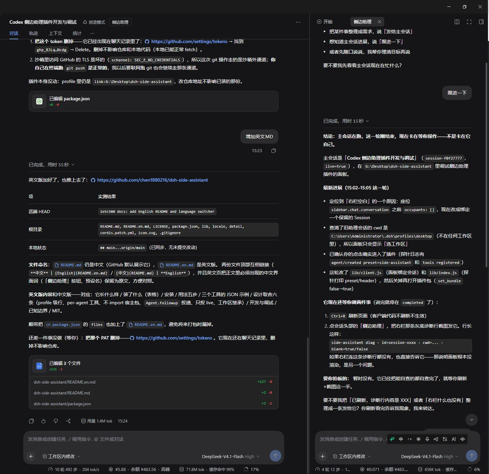
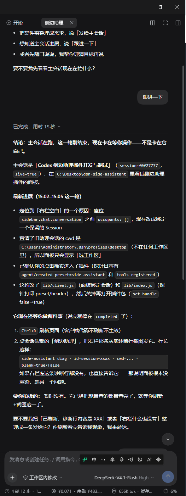

**中文** | [English](README.en.md)

# dsh-side-assistant · 侧边助理



给 [DeepSeek Harness](https://github.com/deepseek-ai)（DSH）加一个**侧边栏里的中文助理**：
它在右侧栏拥有自己的会话，负责把你随口说的需求问清楚、整理成一份可执行的活儿，
再转达给主会话，并在你要的时候回去看主会话干到哪了。

主会话负责干活，它负责"把话说清楚"和"把结果带回来"。

## 它长什么样

- 任意会话标题栏多一个「侧边助理」按钮；
- 点一下 → 右侧栏打开一个标签页，里面就是助理会话，可以直接聊；
- 助理继承当前会话所在的**工作区**，不会弹出"选工作区"；
- 再次点击只是把已开的面板调出来，不会一直新建会话。



## 装了什么

| 组成 | 位置 | 作用 |
|---|---|---|
| `side-assistant` 插件行 | profile 级 | 监听 `agent/created`，只在「侧边助理」预设的会话里注册工具 |
| `preset-side-assistant` | 模式选择器 | 预设「侧边助理」：persona + 时间上下文 + 提问工具 + 上下文压缩 |
| `side_sessions` | 工具 | 列出其它会话（哪个像主会话、是否在跑，`bound: true` 标出你从哪打开的） |
| `side_peek` | 工具 | 读某个会话最近的对话主线（说了什么、调了哪些工具、每轮怎么结束） |
| `side_deliver` | 工具 | 把整理好的需求投递给主会话并唤醒它 |
| `lib/client.js` | 客户端 | 右侧栏面板：资源协议 `sideassistant` + 标签类型 + 会话头部入口按钮 |
| `/api/dsh-side-assistant/bind` | Host 路由 | 面板打开时告诉宿主"我是从哪个会话点开的"，工具默认就操作那个会话 |

**没有 shell、没有文件工具。** 助理只能"说清楚"，不能自己动手改东西——这正是它的边界：
让它只动嘴，你就不用担心它在背后改你的文件。

## 安装

这个 bundle 没有发布到 npm，按本地目录安装：

1. 打开 DSH 的 **插件** 页面 → 添加插件 → 选择本目录（或压缩包解压后的目录）；
2. 或者用内置工具：`plugin_manager` → `install_bundle`，target 填本目录的绝对路径；
3. 装完后**刷新窗口**（`Ctrl+R`）——客户端面板是新的浏览器 bundle，不刷新不会加载。

安装成功时返回里应包含 `"application": "applied"`，并且插件页能看到
`side-assistant`（插件本体）与 `preset-side-assistant`（Agent 预设定义）两个组件都在「运行中」。

## 用法

1. 任意会话头部点「侧边助理」→ 右栏出现助理面板；
2. 随口说一句需求（「帮我把那个导出脚本改一下」这种）；
3. 它会反问、把目标 / 做到什么程度 / 哪些要保留写清楚；
4. 你说「**发给主会话**」→ 它调 `side_deliver`，主会话收到一条「来自会话 xxxx」的消息并开始干活；
5. 你说「**跟进一下**」→ 它调 `side_peek` 读主会话进展，先给结论，再说验证到哪、卡在哪。

**默认目标就是"你从哪个会话点开的那个"**：点按钮时面板会把"来源会话 → 助理会话"记到浏览器本地，
并 POST 给宿主一张绑定表；`side_peek` / `side_deliver` 不带 `session` 参数时直接操作它。
想换目标就显式传 `session`（id、id 前缀或标题片段都行）。

涉及部署、删数据、推代码这类动作时，它会先把"准备怎么说"拿给你看，等你确认再发。

## 三个工具

```jsonc
// side_sessions —— 列出可投递的会话
{ "limit": 10 }

// side_peek —— 读某个会话最近的进展（不传 session 就是绑定的主会话）
{ "session": "session-xxxx 或 id 前缀或标题片段", "limit": 30 }

// side_deliver —— 把需求投递过去（只对 live 会话有效）
{ "text": "把导出的字段顺序改成…", "note": "侧边助理转达：…", "session": "可选" }
```

## 设计取舍

- **插件行放 profile 级，不放进预设里。** 预设的子插件由 `dsh-agent-preset` 按它自己的
  `ctx.baseUrl`（安装目录）解析，`@local/*` 自定义包在那里解析不到，整个预设会变成
  「加载失败」。放在 profile 级由 profile 的解析基准加载才稳。
- **工具按 agent 作用域注册。** `ctx.tools.register` 会按 `scopeOf(ctx)` 分层，
  所以在 `agent/created` 里用 `agent.ctx` 注册，工具天然只对该会话可见，不污染普通会话。
- **不 import `@deepseek-ai/*`。** out-of-tree 插件的裸包名解析只覆盖 profile 里声明的包，
  `import { defineTool } from '@deepseek-ai/dsh-tools'` 会在 import 阶段直接挂掉。
  `lib/index.js` 里自带 `defineLocalTool` / `toSchema`，产出同样形状的 `ToolDefinition`。
  这也是若干第三方 DSH 插件的共同做法。
- **投递走 `Agent.followup`。** 跨独立会话写消息没有现成 Service
  （`ctx.subagents.sendMessage` 只允许同一 subagent tree 成员）；`ctx.agents.get(sessionId)`
  拿到的 live Agent 的 `followup()` 是受支持的"排队一轮并唤醒"通道。消息 source 用
  `{ kind: 'agent-message', form: 'relay', senderSessionId }`，与子 agent 传话的既有约定一致，
  前端会渲染成「来自会话 xxxx」。
- **只投 live 会话。** 历史会话没有 Agent 句柄，`side_deliver` 会明确报错，让你先把它打开。
- **右栏面板是"借壳"的。** DSH 的右栏是"一个会话一个停靠面"。本插件自己注册
  `sideassistant` 资源协议与标签类型，并占用公共座位 `sidebar.chat.conversation`，
  用 `renderFactorySlot('conversation.content', …)` 复用官方会话渲染器，不自己接管消息流。
- **在会话所属工作区里建助理会话。** `sessions.create` 不带 `cwd` 会落到 host 默认目录，
  面板就会显示"选工作区"并把主列切走；所以先用当前会话找到它所属的 workspace，
  再 `connectWorkspace(workspaceId, { agentPreset })` 建会话，最后 `openResource` 打开标签。
- **"从哪打开的"靠自己的路由带过去。** 浏览器 `sessions.create` 只接受
  `{ workspaceId, cwd, sessionId, agentPreset }`，宿主 `ApiSessionCreateRequest` 也只读
  `cwd`/`agentPreset`，`parentSession` 送不过去。于是插件自己注册一条
  `POST /api/dsh-side-assistant/bind`，面板每次打开都推一次"助理会话 → 来源会话"，
  工具执行时按自己的会话 id 查表；浏览器本地另存一份，插件重载后重新绑定。
- **工具在插件重载后不失效。** profile 里 disable→enable 会销毁旧 fiber ctx，闭包里的 `ctx`
  立刻 inactive（报 `cannot get required service "sessionQuery" in inactive context`）。
  所以工具注册时先把服务对象抓出来，执行时优先用 `exec.agent.ctx` 现场解析，
  再回退到抓下来的那份；同时 `apply` 末尾会扫一遍已存在的 agent 补注册工具。

## 开发

```powershell
# 语法检查（用 DSH 自带的 Electron 当 node）
$env:ELECTRON_RUN_AS_NODE = '1'
& '<DSH 安装目录>\DeepSeek Harness.exe' --check .\lib\index.js
& '<DSH 安装目录>\DeepSeek Harness.exe' --check .\lib\client.js
```

改完代码怎么生效：

- 改了 `lib/client.js` → **刷新窗口**（`Ctrl+R`）；
- 改了 `lib/index.js` 或 `cordis.patch.yml` → 用 `plugin_manager` 的 `set_bundle`
  对 `@local/dsh-side-assistant` 先 `enabled: false` 再 `enabled: true`（`install_bundle`
  对已安装的包只会返回 `already-installed`，不会重读 patch）。

调试宿主侧：设置环境变量 `DSH_SIDE_ASSISTANT_DEBUG=1`（写到系统临时目录的
`dsh-side-assistant-debug.log`），或直接给它一个文件路径；不设就完全不写文件。

## 已知边界

- 主会话必须是 **live**（应用里打开着）才能投递。
- 主会话收到的是普通用户消息（带「来自会话 xxx」标记），它不会自动回话给侧边助理；
  要跟进就再问助理一次。
- 面板复用官方 `sidebar.chat.conversation` 座位；如果官方改了座位形状，这里要跟着改。
- 标签页标题固定显示「侧边助理」，暂不支持自定义标题/图标。

## 社区

本开源项目已链接并认可 [LINUX DO](https://linux.do) 社区。

## 许可

MIT
